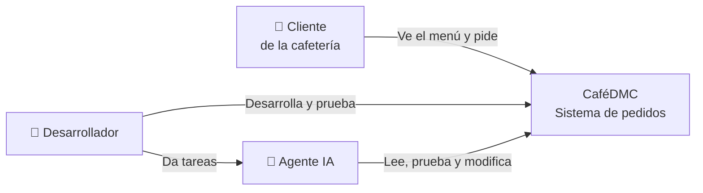
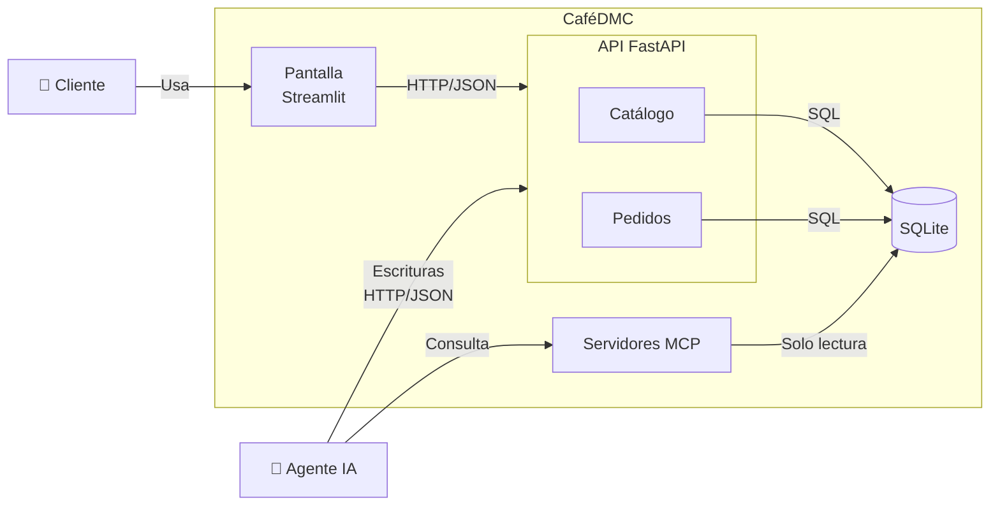
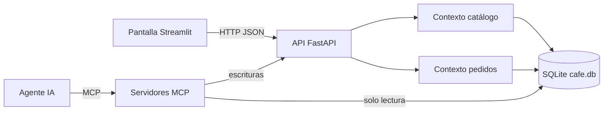
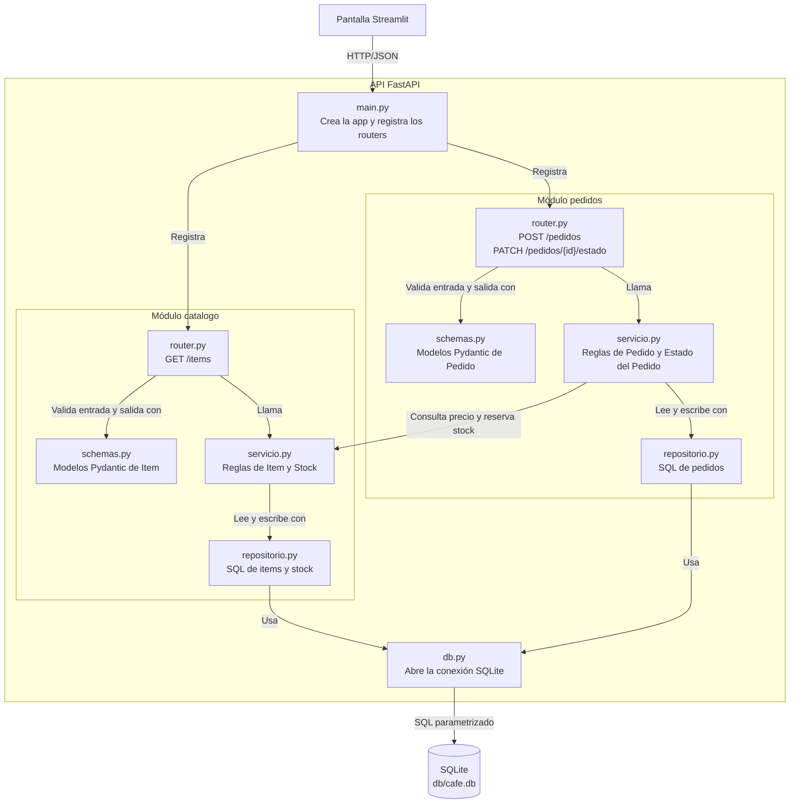

# Arquitectura de CaféDMC

Diagramas C4 de los niveles de contexto, contenedores y componentes. El stack
está en [ADR 0001](adr/0001-stack.md) y el estilo de arquitectura en
[ADR 0002](adr/0002-estilo-arquitectura.md).

## 1. Contexto

Quién usa el sistema.

## 2. Contenedores

Las piezas que se ejecutan dentro de CaféDMC.

Reglas que muestra el diagrama:

- Solo la API escribe en SQLite.
- El agente lee los datos a través de MCP en modo solo lectura. Para cambiar
  datos, usa la API, que aplica las reglas de negocio.

## 3. Componentes de la API

Cómo está organizada por dentro la API FastAPI. Sigue el monolito modular
del [ADR 0002](adr/0002-estilo-arquitectura.md): cada contexto es un módulo
con su router, sus modelos Pydantic, su servicio y su repositorio. Los
endpoints que aparecen son ejemplos.

Responsabilidad de cada componente:

| Componente | Responsabilidad | No debe |
|---|---|---|
| `main.py` | Crear la app FastAPI y registrar el router de cada módulo. | Contener lógica de negocio. |
| `router.py` | Definir los endpoints, recibir y devolver modelos Pydantic, traducir errores a códigos HTTP. | Ejecutar SQL ni decidir reglas de negocio. |
| `schemas.py` | Definir los modelos Pydantic de entrada y salida del módulo. | Acceder a la base de datos. |
| `servicio.py` | Aplicar las reglas de negocio, como las transiciones de estado del pedido (pendiente, pagado, entregado, anulado) o la validación de stock. Es la única puerta de entrada al módulo para los demás módulos. | Escribir SQL directamente. |
| `repositorio.py` | Leer y escribir las tablas del módulo con SQL parametrizado. | Tocar tablas de otro módulo. |
| `db.py` | Abrir la conexión a SQLite y entregarla a los repositorios (por ejemplo, como dependencia de FastAPI). | Conocer las tablas de los módulos. |

Reglas que muestra el diagrama:

- Las llamadas van en un solo sentido: router → servicio → repositorio →
  SQLite.
- Pedidos usa Catálogo solo a través de `catalogo/servicio.py`, nunca a través
  de su repositorio ni de sus tablas.
- Catálogo no depende de Pedidos.
