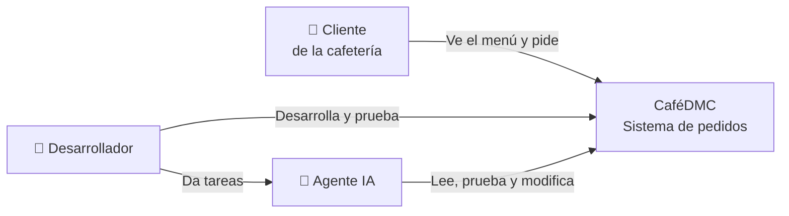
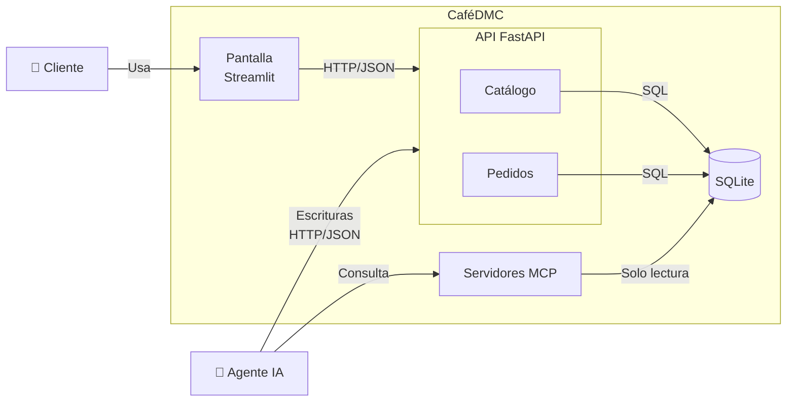

# Arquitectura de CaféDMC

Diagramas C4 de los niveles de contexto y contenedores. El stack está en
[ADR 0001](adr/0001-stack.md).

## 1. Contexto

Quién usa el sistema.



## 2. Contenedores

Las piezas que se ejecutan dentro de CaféDMC.



Reglas que muestra el diagrama:

- Solo la API escribe en SQLite.
- El agente lee los datos a través de MCP en modo solo lectura. Para cambiar
  datos, usa la API, que aplica las reglas de negocio.

```mermaid
flowchart LR
  ui[Pantalla Streamlit] -->|HTTP JSON| api[API FastAPI]
  api --> cat[Contexto catálogo]
  api --> ped[Contexto pedidos]
  cat --> db[(SQLite cafe.db)]
  ped --> db
  agente[Agente IA] -->|MCP| mcp[Servidores MCP]
  mcp -->|solo lectura| db
  mcp -->|escrituras| api